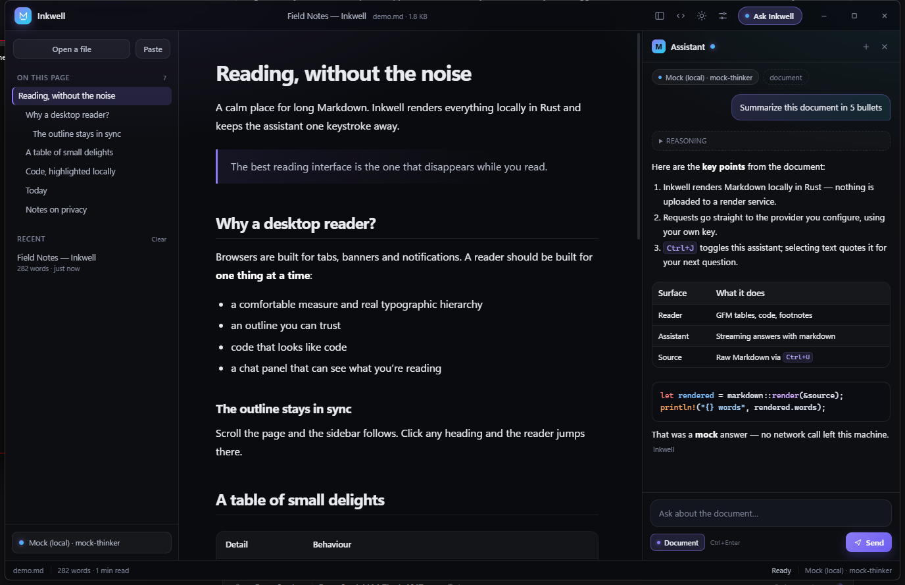

<div align="center">


# Inkwell

### *A sleek Markdown editor & reader with a bring-your-own-key LLM copilot*

**Local Rust rendering &bull; Optional web search &bull; Any provider, your key &bull; Token-by-token streams &bull; No telemetry &bull; Free**

<br />

<!-- Tier 1: project meta -->
<p align="center">
  <a href="https://github.com/LeTrollologist/Inkwell/releases/latest">
    
  </a>
  <a href="src/markdown.rs">
    
  </a>
  <a href="#connect-a-model">
    
  </a>
  <a href="src/llm.rs">
    
  </a>
  <a href="#tests">
    
  </a>
  <a href="LICENSE">
    
  </a>
</p>

<!-- Tier 2: stack -->
<p align="center">
  
  &nbsp;
  
  &nbsp;
  
  &nbsp;
  
</p>

<!-- Tier 3: quick navigation -->
<p align="center">
  <a href="https://github.com/LeTrollologist/Inkwell/releases/latest">
    
  </a>
  &nbsp;
  <a href="#run">
    
  </a>
  &nbsp;
  <a href="#connect-a-model">
    
  </a>
  &nbsp;
  <a href="#keyboard-shortcuts">
    
  </a>
  &nbsp;
  <a href="#architecture">
    
  </a>
</p>

</div>

---

A sleek desktop Markdown editor and reader in Rust with a built-in, bring-your-own-key LLM copilot.

Inkwell renders Markdown locally in Rust (`pulldown-cmark`), displays it in a frameless
WebView2 window driven by `wry` + `tao`, and streams chat completions from the provider of
your choice. Optional web search uses your own search-provider key; queries go directly from
your machine to that provider. No account, no proxy, no telemetry.



```
┌──────────────────────────────────────────────────────────────────────┐
│  M Inkwell     Field Notes - Inkwell · 2.4 KB   ▤  <>  ☾  ⚙  Ask    │
├────────────┬───────────────────────────────────┬─────────────────────┤
│  Open file │  # Reading, without the noise     │  Assistant      + × │
│  Paste     │                                   │  OpenAI · gpt-4o    │
│            │  A calm place for long Markdown.  │                     │
│  ON PAGE   │                                   │  > summarize this   │
│  Why…      │  > The best reading interface…    │                     │
│  Delights  │                                   │  Here are the key   │
│  Code      │  | Detail | Behaviour |           │  points…            │
│            │  |--------|-----------|           │                     │
│  RECENT    │                                   │  [ Document ]  Send │
│  notes.md  │  ```rust                          │                     │
└────────────┴───────────────────────────────────┴─────────────────────┘
```

## Install

**[Download the latest Windows installer →](https://github.com/LeTrollologist/Inkwell/releases/latest)**

1. Run `Inkwell-Setup-<version>.exe`. It installs per user under
   `%LOCALAPPDATA%\Programs\Inkwell`, so there is no administrator prompt.
2. Leave **Open Markdown files with Inkwell** checked if you want `.md`, `.markdown` and `.mdx`
   files to open here. The desktop shortcut is optional.
3. Launch Inkwell and open a document. The copilot is optional; add a provider and key in
   **Settings** (`Ctrl+,`) only when you want it.

Prefer a portable build? Download `inkwell-v<version>-windows-x86_64.zip` and run
`inkwell.exe`. Silent install, upgrade/uninstall, data locations and troubleshooting are in
[INSTALL.md](INSTALL.md).

Release builds are currently unsigned, so Windows SmartScreen may ask you to confirm. SHA-256
checksums and verification commands are published with every release.

## Highlights

- **Fast, local rendering** - GFM tables, task lists, footnotes, strikethrough, code fences and
  KaTeX math, rendered by `pulldown-cmark` in Rust.
- **Editor & reader** - edit Markdown in place, save or save-as, unsaved-change tracking,
  outline with scroll-spy, reading progress, print/PDF, dark & light themes, frameless window
  with native drag and resize.
- **Any model, your key** - OpenAI, Anthropic, Google Gemini, Groq, Mistral, DeepSeek,
  OpenRouter, xAI, Ollama, LM Studio, or any OpenAI-compatible endpoint.
- **Real streaming** - SSE parsing in Rust, token-by-token markdown rendering, a separate
  collapsible *Reasoning* channel for reasoning models, and a Stop button that interrupts a
  stalled request instead of waiting for the next token.
- **Fetch-aware assistant** - Fetch mode retrieves relevant document passages and cites their
  headings; Web search can use your own search key for current sources; Edit mode proposes a
  complete revised document that you review before applying. A thinking toggle requests extended
  reasoning from supported models.
- **Document-aware** - attach the open document to every message, or quote a passage and
  ask about it. Local files open through a native picker or drag/drop, and relative images
  resolve from the document's own folder.
- **Hardened rendering** - raw HTML is escaped, link and image schemes are allow-listed, and
  model answers go through the same renderer as local documents.
- **Keys stay put** - keys live in the OS credential store; the webview never receives them.
- **No npm, no bundler** - the UI is plain HTML/CSS/JS embedded in the executable and served
  over a private protocol.

## Build requirements

For installing the app, see [INSTALL.md](INSTALL.md); the items below are for building from
source.

- Windows 10/11 with **WebView2** (preinstalled on current Windows).
- **Rust** stable, 1.88 or newer (wry uses edition 2024; keyring 4).
- A Windows linker for your toolchain:
  - MSVC toolchain: Visual Studio Build Tools with the Windows SDK.
  - GNU toolchain: **MinGW-w64** (`x86_64-w64-mingw32-gcc`). `scripts\dev.ps1` adds a local
    `tools\w64devkit\bin` folder to `PATH` automatically when present.

  `.cargo\config.toml` pins the GNU target to GCC because the LLVM linker bundled with some
  GNU toolchains miscompiles large binaries on Windows (the app dies at startup with an access
  violation). If you switch to MSVC, the pin does not apply.

  On a fresh clone, install MinGW-w64 (MSYS2 is the least fussy) so
  `x86_64-w64-mingw32-gcc` is on `PATH`. The scripts also prepend `tools\w64devkit\bin` when
  that folder exists. Note that w64devkit 2.10's GCC 16 merged `libgcc_eh` into `libgcc`;
  if the link complains about `-lgcc_eh`, create an empty archive in GCC's lib directory
  (`ar rcs libgcc_eh.a`, then delete it if you upgrade GCC).

**Platform support.** Windows 10/11 is the validated runtime for this release. The wry/tao
shell and the credential layer also compile on macOS and Linux, but those builds are not yet
validated. The native open dialog and drag/drop paths are Windows-only for now; other
platforms fall back to the browser file input. On Linux, persistent key storage requires a
Secret Service provider (GNOME Keyring or KWallet); without one, Inkwell runs with session-only
keys and says so in Settings.

Packaging a release additionally needs Python 3.10+ and Inno Setup 6.3+; see
[RELEASE_PROCESS.md](RELEASE_PROCESS.md).

## Run

```powershell
cd inkwell
cargo run                # or: scripts\dev.ps1
```

UI files are embedded at compile time, so after editing `ui/` rebuild with `cargo run`.

## Build

```powershell
cargo build --release    # or: scripts\build.ps1
```

The executable lands at `target/release/inkwell.exe` and is self-contained (the UI and window
icon are embedded). To build the portable bundle and the per-user installer locally:

```powershell
python scripts\pipeline.py v0.3.2 --no-publish
```

Outputs land in `dist\v0.3.2\`: `inkwell-v0.3.2-windows-x86_64.zip`,
`Inkwell-Setup-0.3.2.exe` and `SHA256SUMS.txt`. The pipeline needs Python 3.10+ and Inno Setup
6.3+; see [RELEASE_PROCESS.md](RELEASE_PROCESS.md) for the full release and publishing flow.

## Connect a model

1. Press <kbd>Ctrl</kbd>+<kbd>,</kbd> (or click the provider chip at the bottom right).
2. Pick a provider from the list.
3. Paste your API key - it goes straight into the OS credential store. Local endpoints do not
   need one.
4. Press **Fetch list** to populate model names, or type one manually.
5. **Save settings** - the dot next to *Assistant* lights up when the provider is ready.

| Provider | Transport | Default base URL |
| --- | --- | --- |
| OpenAI | `openai` | `https://api.openai.com/v1` |
| Anthropic | `anthropic` | `https://api.anthropic.com` |
| Google Gemini | `gemini` | `https://generativelanguage.googleapis.com` |
| Groq | `openai` | `https://api.groq.com/openai/v1` |
| Mistral | `openai` | `https://api.mistral.ai/v1` |
| DeepSeek | `openai` | `https://api.deepseek.com/v1` |
| OpenRouter | `openai` | `https://openrouter.ai/api/v1` |
| xAI | `openai` | `https://api.x.ai/v1` |
| Ollama | `openai` | `http://localhost:11434/v1` |
| LM Studio | `openai` | `http://localhost:1234/v1` |
| Custom | `openai` | whatever you type |

"OpenAI-compatible" covers vLLM, LiteLLM, llama.cpp's server, Together, Fireworks and
anything else that speaks `/chat/completions` with SSE.

Preset model names are starting points and providers rename models often. Use **Fetch list**
to see what your key can actually reach, then pick from the datalist.

### Web search (optional)

Open **Settings → Web search** to enable AI-initiated search. It is off by default and needs
its own bring-your-own-key provider:

| Provider | Authentication | Default endpoint |
| --- | --- | --- |
| Tavily | Bearer API key | `https://api.tavily.com/search` |
| Brave Search | `X-Subscription-Token` | `https://api.search.brave.com/res/v1/web/search` |
| Serper | `X-API-KEY` | `https://google.serper.dev/search` |
| Exa | `x-api-key` | `https://api.exa.ai/search` |
| SearXNG | optional bearer token | `http://localhost:8080/search` |

SearXNG must have JSON output enabled. Keys use the OS credential store under a separate
`search:<provider>` namespace. The model chooses whether to call the search tool; queries and
retrieved excerpts are sent only to the search provider and your selected model provider.
Search results are treated as untrusted reference text and are never executed as instructions.

### Try it without a key

A mock OpenAI-compatible server ships with the repo so the UI can be exercised offline:

```powershell
node scripts\mock-llm-server.js
```

In Settings choose **Custom endpoint**, set the base URL to `http://127.0.0.1:8787/v1`,
model `mock-thinker`, and leave the API key empty. You get streamed Markdown, a reasoning
channel and a fake model list, all local.

## Credential storage

API keys live in the operating system's credential store, keyed by service
`app.inkwell.viewer` and the provider id. `settings.json` contains only non-secret
configuration: providers, models, endpoints, prompts and preferences.

| Platform | Backend |
| --- | --- |
| Windows | Windows Credential Manager |
| macOS | Keychain |
| Linux | Secret Service (GNOME Keyring / KWallet) |

If no credential store is available - for example a headless Linux session without a Secret
Service provider - Inkwell shows a warning in Settings and keeps keys in memory for that
session only. It never falls back to writing keys to disk. Keys are read by the Rust client
immediately before a request; the webview only ever receives a `hasKey` boolean.

Older builds stored keys as `apiKey` entries in `settings.json`. On first launch, Inkwell
imports any such key into the OS credential store and rewrites the file without it. Web-search
keys use a separate `search:<provider>` credential namespace, so a search key can never collide
with a chat provider key.

Web search is off until you configure it. When enabled, the model's search queries and the
resulting pages' excerpts are sent to the search provider you choose, then included in the chat
request to your model provider. Inkwell has no proxy or telemetry; there is no additional
service in the loop.

## Assistant modes

Use the selector in the chat composer:

- **Ask** — normal document Q&A with the full document attached when *Document* is on.
- **Fetch doc** — retrieves the most relevant passages locally, sends them with the question,
  and shows the cited headings as clickable **Sources** under the answer.
- **Web search** — the model can call a web-search tool when it needs current information.
  Configure a search provider and key under *Settings → Web search*; search is off by default.
  Retrieved excerpts are shown in the chat with clickable source links and numbered citations.
  Treat web content as untrusted reference material; Inkwell never executes instructions found
  in search results.
- **Edit doc** — asks the model for a complete revised Markdown document. Review the proposed
  edit and choose **Apply to editor**; nothing is written until you press `Ctrl+S`.
- **Thinking** — enable *Request reasoning / extended thinking* in Settings to ask supported
  OpenAI reasoning models, Anthropic extended thinking, Gemini thinking and OpenRouter
  reasoning for a reasoning pass. Streamed reasoning appears in the collapsible channel.

## Keyboard shortcuts

| Shortcut | Action |
| --- | --- |
| `Ctrl+O` | Open a Markdown file |
| `Ctrl+J` | Toggle the assistant |
| `Ctrl+B` | Toggle the sidebar |
| `Ctrl+U` | Rendered ⇄ Markdown editor |
| `Ctrl+S` | Save the current document |
| `Ctrl+Shift+S` | Save as… |
| `Ctrl+,` | Assistant settings |
| `Ctrl+P` | Print / save as PDF |
| `Enter` | Send (Shift+Enter for a newline) |
| `Ctrl+Enter` | Send from anywhere |
| `Esc` | Close dialogs |

Drag a `.md` file onto the window, use the native **Open** dialog (`Ctrl+O`), or use **Paste**
to render Markdown from the clipboard. Starting Inkwell with a file argument
(`inkwell.exe notes.md`) opens it directly. `.txt` files also work with the viewer.

## Security & privacy

- **Local rendering.** Markdown is parsed in Rust; raw HTML inside a document is escaped
  rather than injected. Link destinations are restricted to http(s), mailto and relative
  paths, and images to http(s), safe raster data URLs or local files, so `javascript:`,
  `file:` and SVG payloads cannot become active content.
- **Local images.** Relative image paths resolve only when a document was opened with a path
  (native picker, drag/drop or command line). The canonical file must stay inside the
  document's folder, use a recognised raster format, and fit the 8 MB per-image / 24 MB total
  budget; bytes are embedded as data URLs rather than exposed as filesystem URLs.
- **Keys stay in the OS keychain.** Windows Credential Manager, macOS Keychain or Linux
  Secret Service (service `app.inkwell.viewer`). The frontend only sees `hasKey` flags, and
  the Rust client reads a key at request time. `settings.json` holds no secrets; WebView state
  (recent documents, theme, chat thread) stays in `%LOCALAPPDATA%\Inkwell\WebView2`.
- **Locked-down webview.** A strict CSP allows only embedded scripts/styles and blocks
  script/XHR network access (`connect-src 'none'`); provider traffic happens in Rust. Remote
  images must use `https:` (the CSP blocks `http:`) and still reveal your IP to that host.
- **External links** are handed to the OS browser; only `http(s)`/`mailto` are accepted.
- **Streaming failures are explicit.** Stop cancels the in-flight HTTP request even when the
  provider has stalled; rate limits include the provider's `Retry-After` hint; interrupted
  streams report an error rather than a false completion.
- **Your data.** The open document is included in a request only when *Document* is
  enabled, and only to the provider you configured.

Inkwell never writes API keys to `settings.json`. If the native credential store is
unavailable, keys are session-only and the settings dialog explains why.


## Architecture

```
inkwell/
├── Cargo.toml
├── CHANGELOG.md
├── INSTALL.md
├── RELEASE_PROCESS.md
├── THIRD_PARTY_NOTICES.md
├── installer/         Inno Setup script for the per-user installer
├── src/
│   ├── main.rs        tao event loop, frameless window, embedded webview, file drop
│   ├── app.rs         IPC dispatch, native file picker, async bridge, asset protocol
│   ├── llm.rs         cancellable OpenAI / Anthropic / Gemini SSE streaming
│   ├── markdown.rs    renderer, outline/anchors, HTML escaping, URL/image sanitising, math
│   ├── fetch.rs       local document retrieval for Fetch mode
│   ├── search.rs      optional web search providers (Tavily, Brave, Serper, Exa, SearXNG)
│   ├── credentials.rs OS credential store + session-only fallback
│   ├── settings.rs    non-secret settings, provider presets, legacy-key migration
│   └── assets.rs      include_bytes! asset map served to the webview
├── ui/
│   ├── index.html     shell markup
│   ├── styles.css     design system, reading typography, print styles
│   ├── app.js         state, document UX, chat streaming
│   ├── bridge.js      invoke/listen over wry's postMessage IPC
│   └── vendor/        highlight.js, KaTeX + fonts (bundled for offline use)
├── assets/icons/      source PNG/ICO icons
├── assets/runtime/    Microsoft WebView2Loader.dll bundled with releases
├── docs/              demo document + screenshot
└── scripts/           dev/build/test, release pipeline, mock provider, icon generator, UI check
```

The window is frameless; dragging and edge resizing are forwarded from the titlebar and
invisible edge strips to native `drag_window` / `drag_resize_window` calls. All document
content is served from memory over `http://inkwell.localhost`, so nothing depends on the
working directory.

Frontend → Rust commands (JSON over `window.ipc.postMessage`):

| Command | Purpose |
| --- | --- |
| `render_markdown` | Markdown → HTML + outline + word count |
| `get_settings` / `save_settings` | Masked settings view / merge + persist |
| `list_models` | Provider model discovery |
| `chat` | Spawn a streaming completion (`llm:delta/done/error` events; Web mode also emits `search:*` activity) |
| `fetch_document` | Local heading-aware document retrieval |
| `cancel_chat` | Cooperative cancellation for one stream, including in-progress web searches |
| `open_external` | Open a link in the system browser |
| `initial_document` | File passed on the command line |
| `app_info` | Version and settings path |
| `win_*` | Minimize / maximize / close / drag / resize |

Events are request-scoped by a generated id, so overlapping streams can never mix.

## Tests

```powershell
scripts\test.ps1         # or: cargo test
node scripts\check-ui.js # duplicate functions / missing ids / markup balance
```

The suite has **72 tests**. It covers anchor-id generation and deduplication, front-matter
extraction, escaping of raw HTML and LLM-style injection payloads, URL-scheme sanitisation,
malformed documents, GFM tables/task lists, KaTeX math wrappers, relative-image containment
and embedding, local fetch retrieval and citations, web-search request construction and
provider response parsing, external-content sanitisation, rate-limit handling, SSE parsing for
all three transports, request construction (including reasoning/thinking options), tool-call
planning and JSON fallback, cancellation/interrupted streams/rate-limit and 5xx handling
against a local mock server, document saving, credential lookup/migration and key masking.

The release pipeline runs these checks before packaging and aborts on failure; see
[RELEASE_PROCESS.md](RELEASE_PROCESS.md).

## Notes & limitations

- Inkwell is an **editor and reader**: Markdown can be edited in the source pane and saved with
  `Ctrl+S`; AI edits are only applied after you review and confirm them.
- Relative images are embedded as data URLs and must live inside the document's folder.
  Documents opened through the browser file-input fallback (non-Windows, or the hidden input)
  have no filesystem path, so their relative images stay unresolved.
- Embedded images are capped at 8 MB each and 24 MB per render; remote images must use `https:`.
- Math is rendered locally with bundled KaTeX (`$…$` and `$$…$$`); unsupported TeX syntax is
  shown as an error rather than executed.
- The application icon and version metadata are embedded in the PE, so Explorer and shortcuts
  show the Inkwell icon.
- Release builds are unsigned, so Windows SmartScreen may warn on first launch. SHA-256
  checksums and verification commands are published with every release; see
  [INSTALL.md](INSTALL.md).
- Windows 10/11 is the validated runtime. Linux and macOS builds are not yet tested; on Linux,
  `reqwest` uses native TLS (`libssl-dev`/`pkg-config` for builds) and persistent keys need a
  Secret Service provider such as GNOME Keyring or KWallet.

## License

MIT — see [LICENSE](LICENSE).

